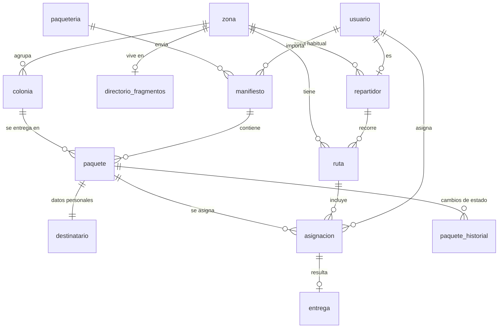

# Modelo relacional

Tablas de Zonalia, cómo se relacionan y por qué están normalizadas. El SQL está en `db/esquema/` (las tablas en `001_tablas.sql`).

## Diagrama entidad-relación

## Tablas

| Tabla | Guarda | Llave primaria |
| --- | --- | --- |
| `zona` | Zonas de reparto de la ciudad | `zona_id` |
| `colonia` | Colonias de SEPOMEX y su zona | `colonia_id` (id de SEPOMEX) |
| `paqueteria` | Empresa que envía el manifiesto (hoy J&T) | `paqueteria_id` |
| `usuario` | Cuentas de admin, supervisor y repartidor | `usuario_id` |
| `repartidor` | Datos que solo tiene un repartidor | `usuario_id` |
| `manifiesto` | Archivo de paquetes recibido cada día | `manifiesto_id` |
| `paquete` | Cada paquete, particionado por zona | `(zona_id, paquete_id)` |
| `destinatario` | Datos personales del destinatario | `(zona_id, paquete_id)` |
| `ruta` | Ruta de un repartidor en un día | `ruta_id` |
| `asignacion` | Qué paquete va en qué ruta y en qué orden | `asignacion_id` |
| `entrega` | Resultado de una asignación, con evidencia | `entrega_id` |
| `directorio_fragmentos` | En qué partición y nodo vive cada zona | `zona_id` |
| `paquete_historial` | Cada cambio de estado de un paquete, con fecha y usuario (#11) | `historial_id` |

## Normalización

**1FN.** Cada columna guarda un solo valor y no hay grupos repetidos. Por ejemplo, los paquetes de una ruta no van como lista dentro de `ruta`: cada uno es una fila de `asignacion`.

**2FN.** En las tablas con llave compuesta, cada columna depende de la llave completa. En `paquete`, la llave es `(zona_id, paquete_id)`, y la guía, el peso y el estado dependen del paquete, no solo de la zona. En `destinatario` pasa lo mismo.

**3FN.** Ninguna columna depende de otra que no sea llave. El nombre de la zona vive solo en `zona`. El nombre de la paquetería vive solo en `paqueteria`. Los datos del usuario no se repiten en `repartidor`, que solo guarda lo propio de un repartidor.

**La excepción, y por qué es segura.** `paquete` guarda `zona_id` aunque la zona se puede saber por la colonia. Es necesario, porque PostgreSQL particiona por una columna de la misma tabla y la zona es la llave de fragmentación (ADR-001). Para que nunca se contradiga, `paquete` tiene una llave foránea compuesta `(colonia_id, zona_id)` hacia `colonia`: la base rechaza un paquete cuya zona no sea la de su colonia.

## Fragmentación

- **Horizontal:** `paquete` está declarada con `PARTITION BY LIST (zona_id)`. Por ahora todo cae en la partición `paquete_sin_zona`. En el issue #12, cuando el equipo cierre las zonas (#9), se crea una partición por zona y se registra en `directorio_fragmentos`.
- **Vertical:** `destinatario` separa los datos personales del paquete. Comparte su llave, así que se une 1 a 1 sin perder información.

## Reglas en la base: procedimiento, funciones y triggers (#11)

Las reglas que no se pueden romper viven en la base y no solo en la API. Así se cumplen aunque alguien entre directo con `psql` o la API tenga un error.

| Archivo | Qué crea | Para qué |
| --- | --- | --- |
| `003_historial.sql` | Columna `paquete.actualizado_en` y tabla `paquete_historial` | Saber cuándo cambió un paquete y por qué estados pasó |
| `004_funciones.sql` | `zona_de_colonia(colonia)` y `carga_repartidor(repartidor, fecha)` | Dar la zona de una colonia al importar y contar los paquetes del día de un repartidor |
| `005_asignar_paquete.sql` | Procedimiento `asignar_paquete(zona, paquete, repartidor, asignado_por, fecha)` | Asignar en un solo paso: bloquea el paquete y al repartidor, revisa estado, zona y capacidad, agrega el paquete a la ruta del día y la ordena por colonia |
| `006_triggers.sql` | `paquete_validar_transicion`, `paquete_fecha_actualizacion`, `paquete_historial` | Rechazar cambios de estado inválidos, poner la fecha de actualización y guardar el historial |

**Cambios de estado permitidos:** `recibido → asignado`; `asignado → en_ruta` o `recibido`; `en_ruta → entregado` o `fallido`; `fallido → asignado` (otro intento) o `devuelto`. `entregado` y `devuelto` son finales.

**Por qué no se asigna dos veces.** `asignar_paquete` lee el paquete con `SELECT … FOR UPDATE`. Si dos supervisores asignan el mismo paquete al mismo tiempo, el segundo espera a que termine el primero y después ve que ya está `asignado`.

**Por qué no se pasa la capacidad.** El procedimiento también bloquea la fila del repartidor antes de contar su carga. Así, dos asignaciones simultáneas al mismo repartidor no pueden contar la misma carga.

**Errores.** Cada regla rota lanza un código propio, que la API traduce a las excepciones del dominio (#20, #21):

| Código | Significa |
| --- | --- |
| `ZN001` | El paquete ya está asignado o su estado no permite asignarlo |
| `ZN002` | El repartidor llegó a su capacidad del día |
| `ZN003` | Cambio de estado no permitido |
| `ZN004` | La colonia no existe en el catálogo |
| `ZN005` | El paquete y el repartidor son de zonas distintas |
| `ZN006` | El paquete o el repartidor no existen |

**Pruebas.** `db/pruebas/011_asignacion.sql` comprueba 8 casos dentro de una transacción que se deshace al final:

1. Las funciones dan la zona correcta y rechazan una colonia que no existe.
2. Una asignación correcta deja el paquete en `asignado`.
3. Un paquete no se asigna dos veces.
4. No se pasa la capacidad, y el intento fallido no deja cambios.
5. No se asigna un paquete a un repartidor de otra zona.
6. La ruta queda ordenada por colonia.
7. Un cambio de estado inválido se rechaza.
8. El historial guarda cada cambio con su fecha y su usuario.