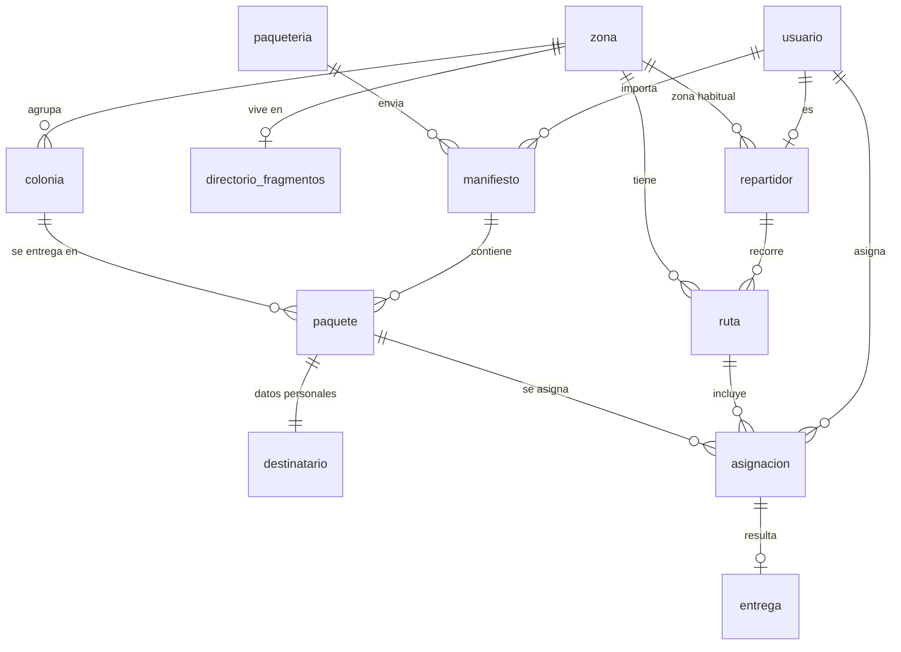

# Modelo relacional

Tablas de Zonalia, cómo se relacionan y por qué están normalizadas. El SQL está en `db/esquema/001_tablas.sql`.

## Diagrama entidad-relación

## Tablas

| Tabla | Guarda | Llave primaria |
| --- | --- | --- |
| `zona` | Zonas de reparto de la ciudad | `zona_id` |
| `colonia` | Colonias de SEPOMEX y su zona | `colonia_id` (id de SEPOMEX) |
| `paqueteria` | Empresa que envía el manifiesto (hoy J&T) | `paqueteria_id` |
| `usuario` | Cuentas de admin, supervisor y repartidor | `usuario_id` |
| `repartidor` | Datos que solo tiene un repartidor | `usuario_id` |
| `manifiesto` | Archivo de paquetes recibido cada día | `manifiesto_id` |
| `paquete` | Cada paquete, particionado por zona | `(zona_id, paquete_id)` |
| `destinatario` | Datos personales del destinatario | `(zona_id, paquete_id)` |
| `ruta` | Ruta de un repartidor en un día | `ruta_id` |
| `asignacion` | Qué paquete va en qué ruta y en qué orden | `asignacion_id` |
| `entrega` | Resultado de una asignación, con evidencia | `entrega_id` |
| `directorio_fragmentos` | En qué partición y nodo vive cada zona | `zona_id` |

## Normalización

**1FN.** Cada columna guarda un solo valor y no hay grupos repetidos. Por ejemplo, los paquetes de una ruta no van como lista dentro de `ruta`: cada uno es una fila de `asignacion`.

**2FN.** En las tablas con llave compuesta, cada columna depende de la llave completa. En `paquete`, la llave es `(zona_id, paquete_id)`, y la guía, el peso y el estado dependen del paquete, no solo de la zona. En `destinatario` pasa lo mismo.

**3FN.** Ninguna columna depende de otra que no sea llave. El nombre de la zona vive solo en `zona`. El nombre de la paquetería vive solo en `paqueteria`. Los datos del usuario no se repiten en `repartidor`, que solo guarda lo propio de un repartidor.

**La excepción, y por qué es segura.** `paquete` guarda `zona_id` aunque la zona se puede saber por la colonia. Es necesario, porque PostgreSQL particiona por una columna de la misma tabla y la zona es la llave de fragmentación (ADR-001). Para que nunca se contradiga, `paquete` tiene una llave foránea compuesta `(colonia_id, zona_id)` hacia `colonia`: la base rechaza un paquete cuya zona no sea la de su colonia.

## Fragmentación

- **Horizontal:** `paquete` está declarada con `PARTITION BY LIST (zona_id)`. Por ahora todo cae en la partición `paquete_sin_zona`. En el issue #12, cuando el equipo cierre las zonas (#9), se crea una partición por zona y se registra en `directorio_fragmentos`.
- **Vertical:** `destinatario` separa los datos personales del paquete. Comparte su llave, así que se une 1 a 1 sin perder información.